# Downtown track-side asset kit (prototype)

Branch `exp/track-kit`. Built in a GPU-less container (4 cores, 15 GB, Mesa lavapipe) on
2026-10-27, in parallel with M2 and without touching `racer-sim`, `racer-trackc`, `racer-game`
race code or `data/tracks/`. Everything below is generated by code in the repo from text inputs
and fixed seeds; nothing is hand-edited and nothing needs an account or a key.

## What was built

| Item | Where | Notes |
|---|---|---|
| Kit crate | `crates/racer-citykit` | Pure generators (meshes, textures, layouts are functions of inputs and a seed) plus the Bevy side (materials, batching, lighting, showcase). |
| Centrelines | `path.rs` | Chains of straights and circular arcs (right-handed headings, −Z forward), evaluated at any arc length and lateral offset; offset curves get their own arc length. |
| Road sweep | `road.rs` | Cross-section (lanes, 2 % camber from the crown, 0.5 m concrete gutter pan, 150 mm kerb with a chamfered arris, 4.5 m sidewalk rising 1.5 %) swept along a path. Side-street mouths cut kerb and sidewalk and fill with asphalt. Carriageway UV0 = (lateral offset, centreline arc length) in metres. Kerbs and sidewalks are watertight slabs with end caps. |
| Road decals | `road.rs`, `texture::decal_atlas` | Seeded scatter of utility trench patches, longitudinal and branching cracks, round and square manholes, gutter drains, oil stains, sealed seams and tyre skid marks concentrated in braking zones; quads follow the camber, 15 mm above the road, alpha-blended. |
| Wet surface material | `crates/racer-render/src/surface.{rs,wgsl}` | `StandardMaterial` extension shared by road, kerbs, sidewalks, curbs and decals: procedural markings in the shader (double yellow centre, 3 m / 12 m lane dashes, edge lines, continental crosswalks, stop lines, chequered start line; worn by noise), polished and darker wheel tracks and oil drip lines per lane, gutter pan with joints and grime, and the PLAN section 6 wetness model: porosity darkening, roughness drop, puddles that collect in cavities, gutters and wheel tracks and flatten the normal map. A global `Wetness` resource drives every surface. Forward and deferred (for SSR). |
| Racing furniture | `props/racing.rs` | Red/white rumble curbs, New Jersey barriers (3.8 m units, 20 mm joints, swept profile), double W-beam Armco on posts, tyre walls (four-high stacks, two rows, belt facing), catch fencing (cranked posts, chain-link panels with alpha-to-coverage, tension cables), sponsor scrims on the fence, start/finish gantry (truss towers and beam, chequered banner, five-column start lights with sockets), sector board with LED seven-segment digits, braking distance boards, temporary grandstand (scaffold, tiers, 864 seats, canopy) and a seated crowd. |
| Street furniture | `props/street.rs` | 9 m LED street lamps (single/double arm, spot-light sockets aimed 10° across the street), traffic signals (mast arm, three-aspect heads with visors and backplates, one aspect lit), road signs from a sign atlas (speed limit, no parking, no entry, street name, one way, stop, pedestrian crossing, bus stop), bollards, bins, benches, bus shelter (glass, lightbox, light socket), hydrants, parking meters, controller cabinets, street trees in pits (seeded), parked-car placeholders. |
| Façade kit and block assembler | `building.rs`, `data/city/districts/downtown.toml` | Convex blocks are cut into lots along their frontage; each lot is assembled from modules chosen by the district rules: ground-floor shopfronts (pilasters, stall risers, recessed glazing with bars, fascia with sign, optional awning), punched-window bays (recess reveals, frames, sills, lintels), string courses, classical cornices, parapets with coping, curtain-wall bays (spandrels, fins, transoms, lit and dark interiors per floor), fire escapes, rooftops (AC units, bulkheads, wooden water towers). Three archetypes (glass tower on a podium, stone office, brick loft) with palettes. Each building also has a massing-shell LOD. |
| Procedural textures | `texture.rs` | Tileable, seeded, with CPU mip chains: weathered asphalt (aggregate, binder, blotches; height in alpha), sidewalk slabs with joints and gum, cast concrete, kerb stone, brick, render/plaster, roof gravel, curb paint with rubber, chain-link, window interiors atlas, shop sign atlas, road sign atlas, decal atlas, chequer, distant-façade window grid (day + lit mask). PBR sets are albedo + normal + packed occlusion/roughness/metallic. |
| Scanned textures (default) | `data/city/textures/polyhaven.toml`, `tools/fetch_textures.sh` | Six Poly Haven 2k PBR sets (asphalt, sidewalk, brick, render, barrier concrete, kerb) fetched by `tools/setup.sh` with md5 checks, albedo-normalised to plausible values; procedural fallback per material. See "Texture sources". |
| Validation | `validate.rs`, `catalogue.rs`, `racer-citykit validate` | Every asset in the catalogue (38 assets with LOD chains and sockets) checked for naming (`road_`/`race_`/`furn_`/`bldg_`/`decal_` + snake case), triangle budget per asset, LOD ratio (≤ 80 % of the previous LOD), attribute consistency, finite positions, unit normals, UV ranges (atlas parts in [0, 1], tiling parts finite), watertightness and outward orientation of every piece declared closed, socket validity. |
| Bevy integration | `materials.rs`, `batch.rs`, `lighting.rs` | One material per slot (emissives in nits with exposure applied), per-building tinted copies, static batching into 60 m cells per material and LOD band with `VisibilityRange` LOD switching, time-of-day presets (sun/moon, physical atmosphere, exposure, AgX, bloom, colour grading, night sky-glow dome, SSR for wet). |
| Showcase street | `showcase.rs`, `racer-capture scene downtown-kit*` | ~470 m street-circuit section, dressed over 400 m: 230 m straight, 90° right-hander (R 30 m), 190 m straight; three side streets (two-lane, parked cars, signals, closed with bollards), barriers, fences, tyre wall, curbs, gantry and boards, grandstand plaza with crowd and landmark tower, 41 assembled buildings plus a landmark tower, massing infill for the rest of the street grid and a distant skyline. |
| Blender review | `pipelines/blender/kit_review.py`, `tools/kit_review.sh` | Exports the catalogue as OBJ and renders a labelled Cycles contact sheet with an independent mesh report from Blender's bmesh. Written and syntax-checked, **not run in this session** (the run was cancelled); the Rust validator is the gate. |


## How to regenerate

```sh
tools/setup.sh                                   # also fetches the scanned textures (md5-checked)
cargo test -p racer-citykit -p racer-render      # generators, validator, layout budgets
cargo run -p racer-citykit -- validate           # per-asset table: LOD triangles, sockets, size, result
cargo run -p racer-citykit -- stats              # showcase draws and triangles
cargo run -p racer-citykit -- textures out/tex   # every procedural texture as PNG
cargo run -p racer-citykit -- obj out/obj        # every asset/LOD as OBJ + kit.mtl
tools/capture.sh downtown-kit captures/kit                 # day (also -golden, -night, -wet, -procedural)
tools/kit_review.sh out/review                   # Blender contact sheet + bmesh report (needs --with-blender)
```

Inputs that define the look: `data/city/districts/downtown.toml` (archetypes, palettes, ground,
roof and street-furniture rules), `data/city/textures/polyhaven.toml` (scans and their md5s),
the seeds in `showcase.rs`, `materials.rs` (slot materials and per-preset glow) and
`lighting.rs` (sun, exposure, grading). Changing any of them and re-running the capture is the
iteration loop used for every image below.

## Texture sources and licences

| Texture | Default: scan (Poly Haven, 2k, CC0 1.0) | Fallback: procedural |
|---|---|---|
| Asphalt (road, mouths) | `asphalt_track` by Dimitrios Savva (2 m tile) | `texture::asphalt` (4 m) |
| Sidewalk | `concrete_pavement` by Charlotte Baglioni (1.8 m) | `texture::paving` (3 m) |
| Brick | `red_brick_03` by Rob Tuytel (1 m, softened per-building tint) | `texture::brick` (0.9 m) |
| Render / stone trim | `plastered_wall_04` by Rob Tuytel (3.2 m) | `texture::plaster` (3 m) |
| Barrier concrete | `concrete_wall_008` by Dario Barresi and Charlotte Baglioni (2.71 m) | `texture::concrete` (2 m) |
| Kerb stone | `concrete_floor_02` by Rob Tuytel (2 m) | `texture::concrete` (1 m) |
| Roof gravel, curb paint, chain-link, decal atlas, window/shop-sign/road-sign atlases, chequer, distant façades | procedural only | – |

Probe results (2026-10-27, from this container, no keys): `api.polyhaven.com` and its
`dl.polyhaven.org` file URLs, `ambientcg.com` (API and zip downloads) and the Hugging Face API
were reachable. Open-weight texture/material generators (for example models on Hugging Face)
could be downloaded, but none can run usefully on a 4-core CPU-only container within a session,
so none were used. Poly Haven was chosen over ambientCG because it serves individual files per
map (1k JPG, ~0.3–1.2 MB) with an md5 per file from its public API, so the fetch script can pin
exactly what it downloads. Both sites publish CC0 assets: no attribution needed, authors are
recorded in `data/city/textures/polyhaven.toml` anyway.

Policy (changed during the session at the user's request: "highest quality" over the
CC0/procedural-only constraint): the scanned 2k sets are the default for every showcase
preset; `tools/setup.sh` fetches them with md5 checks into the git-ignored
`assets/textures/polyhaven/`. The procedural set remains as an offline fallback (per material,
when a file is missing) and as the `downtown-kit-procedural` comparison scene. All decals,
atlases, curbs and distant façades stay procedural because no scan matches them.

## Budgets

Per asset (`racer-citykit validate`, all pass; LOD switch at 70 m for props, 180 m for buildings):

| Asset | LOD0 tris | LOD1 tris | Sockets |
|---|---|---|---|
| `road_avenue_straight_20m` | 240 | - | 0 |
| `road_avenue_corner_r30` | 2132 | - | 0 |
| `road_avenue_junction` | 236 | - | 0 |
| `decal_road_set_60m` | 102 | - | 0 |
| `race_barrier_jersey` | 152 | - | 0 |
| `race_curb` | 166 | - | 0 |
| `race_armco` | 400 | - | 0 |
| `race_tirewall` | 6404 | 3236 | 0 |
| `race_catch_fence` | 320 | 152 | 0 |
| `race_gantry_start` | 2444 | 312 | 10 |
| `race_board_sector` | 120 | - | 0 |
| `race_board_distance` | 192 | - | 0 |
| `race_fence_banners` | 32 | - | 0 |
| `race_grandstand_crowd` | 14664 | - | 0 |
| `race_grandstand` | 33048 | 1816 | 0 |
| `furn_lamp_single` | 184 | 120 | 1 |
| `furn_lamp_double` | 272 | 192 | 2 |
| `furn_traffic_signal` | 500 | 282 | 3 |
| `furn_sign_speedlimit` | 132 | 82 | 0 |
| `furn_sign_noparking` | 132 | 82 | 0 |
| `furn_sign_streetname` | 46 | - | 0 |
| `furn_sign_oneway` | 46 | - | 0 |
| `furn_sign_stop` | 46 | - | 0 |
| `furn_sign_pedestrian` | 46 | - | 0 |
| `furn_sign_busstop` | 46 | - | 0 |
| `furn_sign_noentry` | 132 | 82 | 0 |
| `furn_bollard` | 144 | 72 | 0 |
| `furn_bin` | 168 | 84 | 0 |
| `furn_bench` | 108 | - | 0 |
| `furn_bus_shelter` | 254 | 146 | 1 |
| `furn_hydrant` | 288 | 168 | 0 |
| `furn_parking_meter` | 56 | - | 0 |
| `furn_utility_cabinet` | 24 | - | 0 |
| `furn_tree` | 348 | 104 | 0 |
| `furn_car_parked` | 324 | 212 | 0 |
| `bldg_glass_tower` | 12656 | 24 | 0 |
| `bldg_stone_office` | 18804 | 12 | 0 |
| `bldg_brick_loft` | 11266 | 12 | 0 |

Showcase street (`racer-citykit stats`, `cargo test` enforces < 1000 draws, < 900k near and
< 700k far triangles):

| Measure | Value |
|---|---|
| Mesh entities (draws before culling; 60 m cells × material × LOD band) | 760 |
| Visible after culling, typical street-level pose | 200–470 |
| Triangles, everything at LOD0 | 766k |
| Triangles beyond the LOD switches | 114k |
| Buildings | 41 assembled + landmark tower, plus massing infill and skyline |
| Lights | 42 lamp spot lights + bus shelter (golden/night/wet only), no shadows except the sun |
| Generation time (meshes + layout) | 0.13 s |
| Texture setup (debug build, 2k scans decoded, CPU mips) | 7–8 s; procedural set ~2.5 s |
| Frame time on lavapipe, 1280×720 | 1.3–1.7 s (software rasterisation on 4 CPU cores; not a GPU number) |

The frame time is dominated by lavapipe rasterising and shading on the CPU; the CPU-side cost
that matters for the game (entities, draws, triangles, lights) is in the budgets above and is
kept low by static batching and LOD bands.

## Screenshots

All captured headlessly on lavapipe at 1280×720 with `tools/capture.sh downtown-kit[-golden|-night|-wet|-procedural]`
(7 scripted poses each; the dry night skips the overhead drone pose, which is almost black and
fails the harness's image check). Every image was inspected while tuning; the selection below
is the final pass. Scanned textures unless noted.

### Day
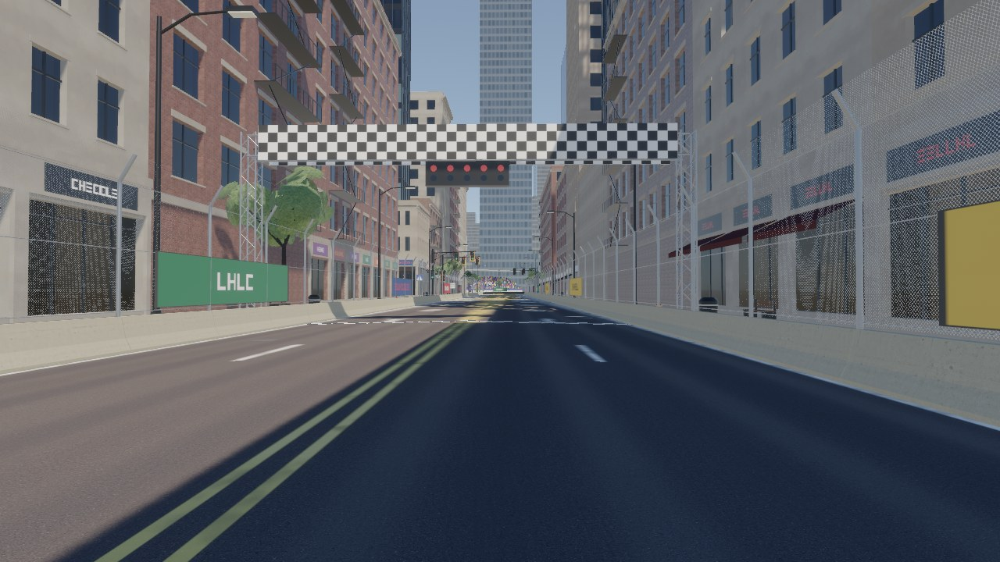
*Start/finish gantry with start lights, chequered line, catch fences with scrims, shopfronts.*
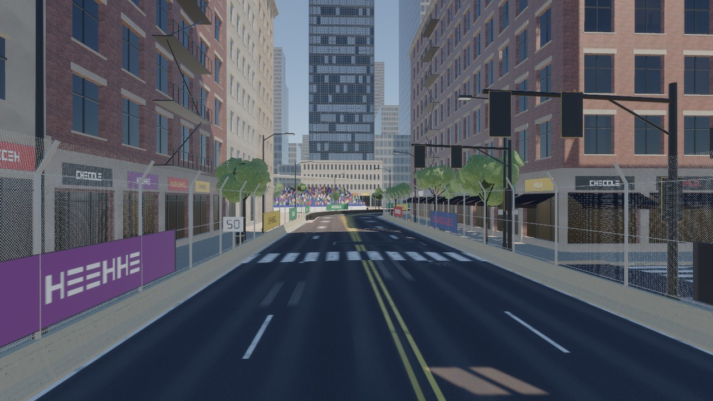
*Braking zone: crosswalk, 50 m board, signal mast, grandstand with crowd at the corner, landmark tower closing the view.*
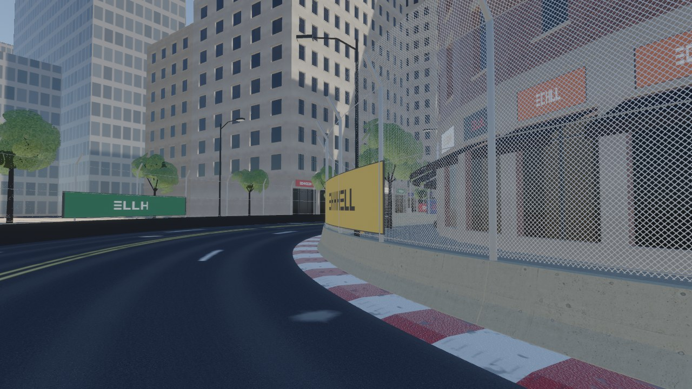
*Apex of the 90° right-hander: red/white curb, jersey barrier and fence, inner-corner building following the arc.*
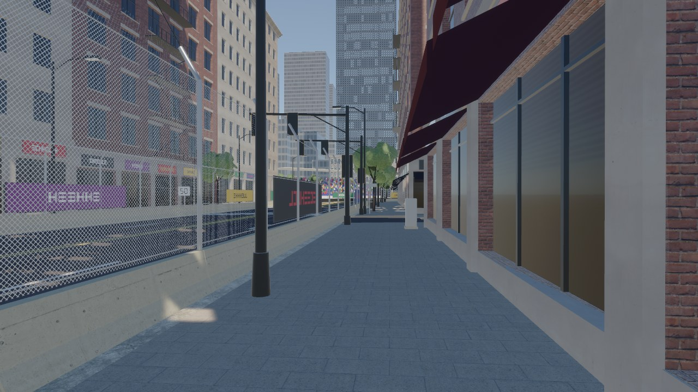
*Sidewalk: lamps, trees, bins, bench, awnings and pilasters; scanned pavers, brick and concrete.*
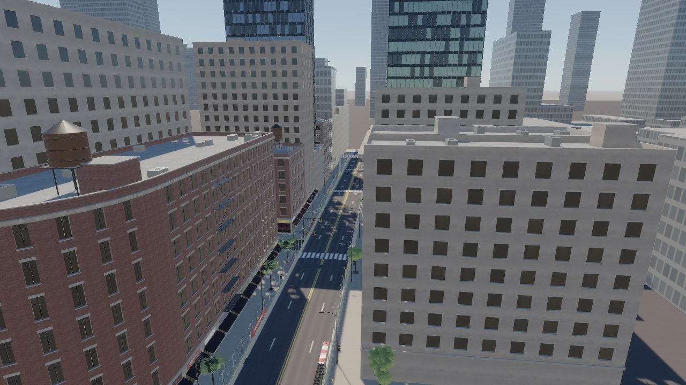
*Drone view down the first straight: assembled blocks with secondary façades, rooftops with water towers and AC units.*

### Golden hour
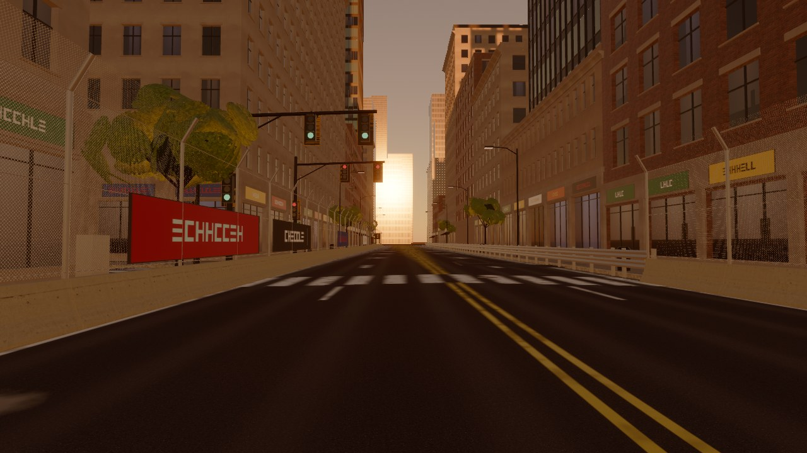
*Golden hour on the second straight (sun 7° down the street axis, warm grade).*
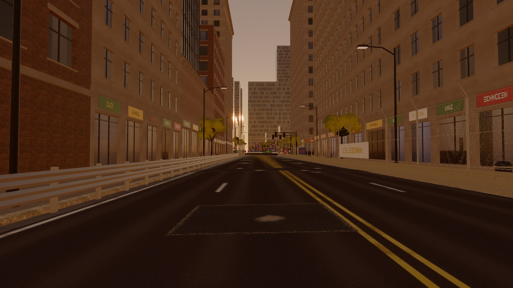
*Looking west into the low sun past Armco and shopfronts.*
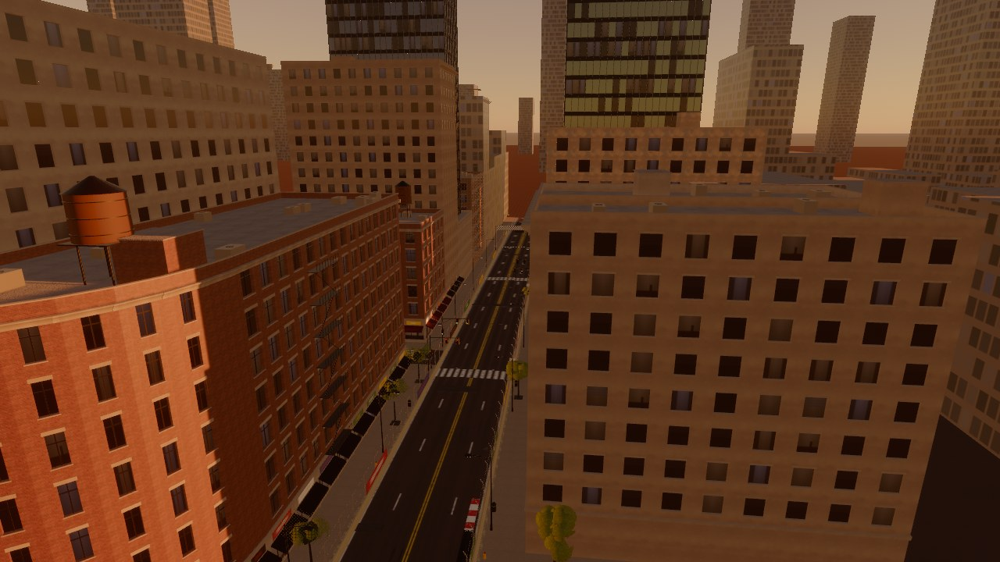
*Golden hour from above.*

### Night
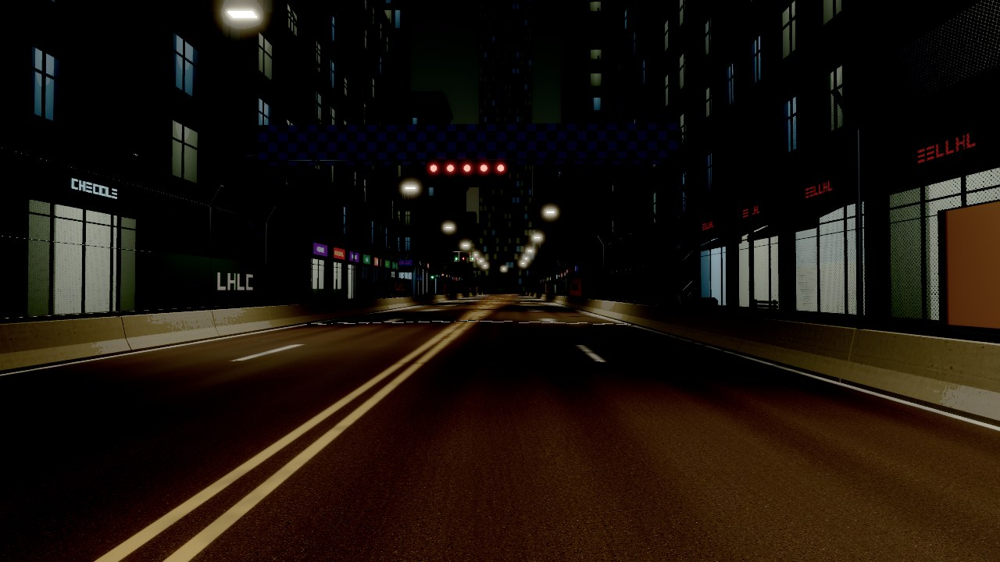
*Night: LED street lights pooling on the road, lit windows, shop signs, red start lights, sky-glow dome.*
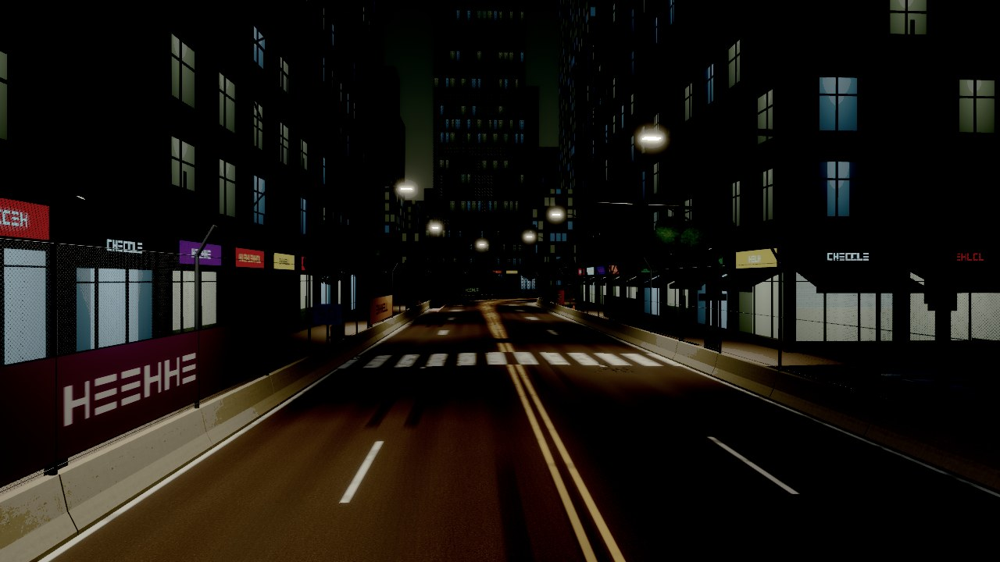
*Night braking zone.*
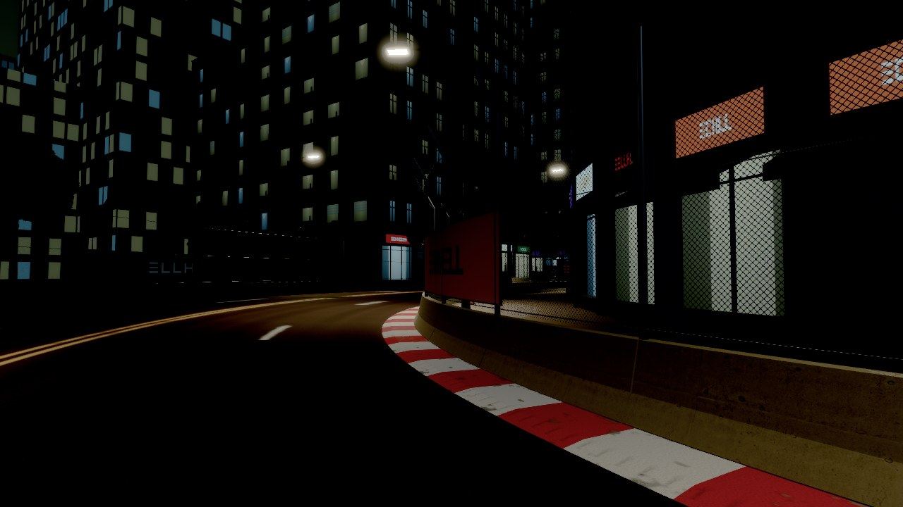
*Night apex.*
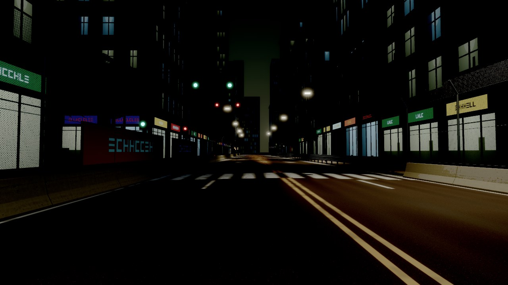
*Night exit straight with signals.*

### Wet (night, deferred + SSR + TAA)
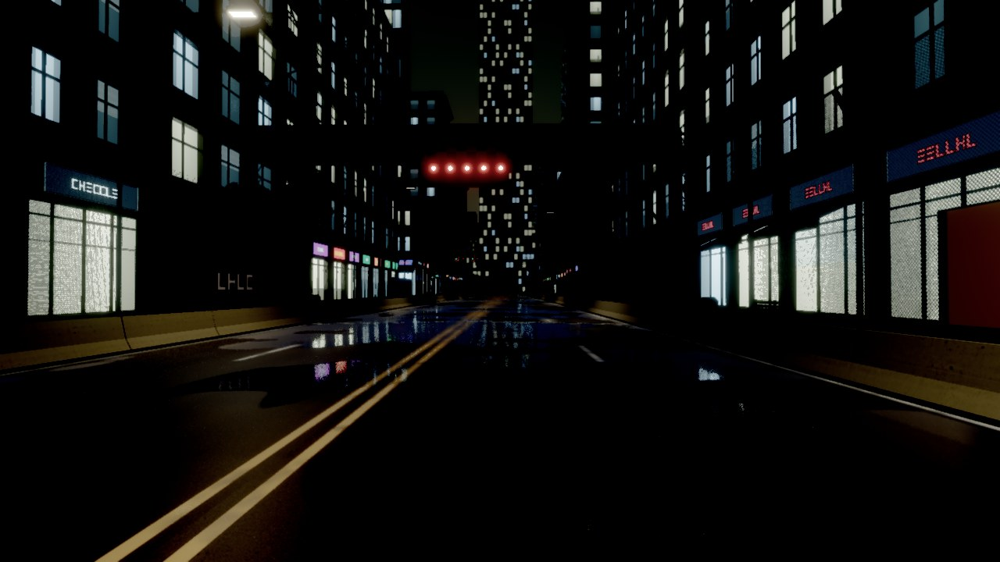
*Wet: puddles in the gutters and wheel tracks mirror shopfronts, signs and the start lights.*
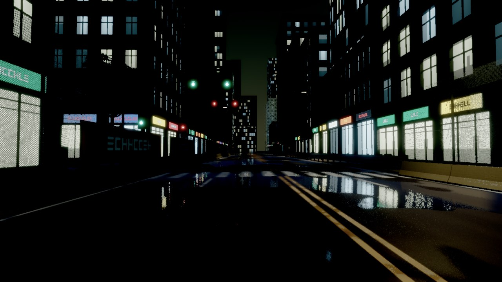
*Wet exit straight.*
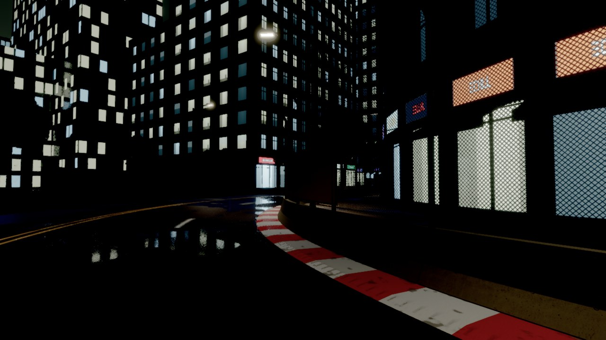
*Wet apex: wet curb paint and kerbs.*
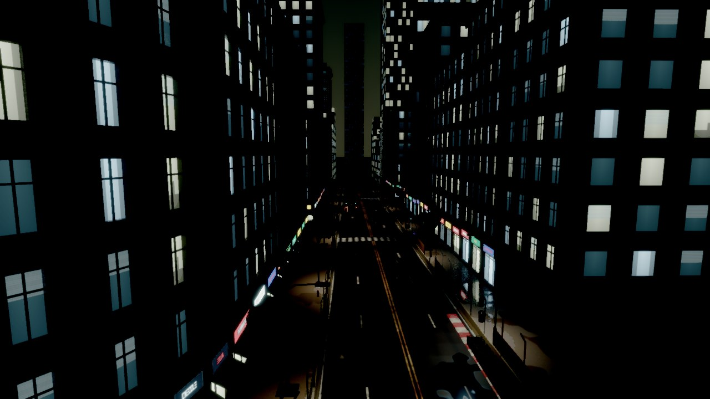
*Wet street canyon from above.*

### Procedural fallback (no downloaded textures)
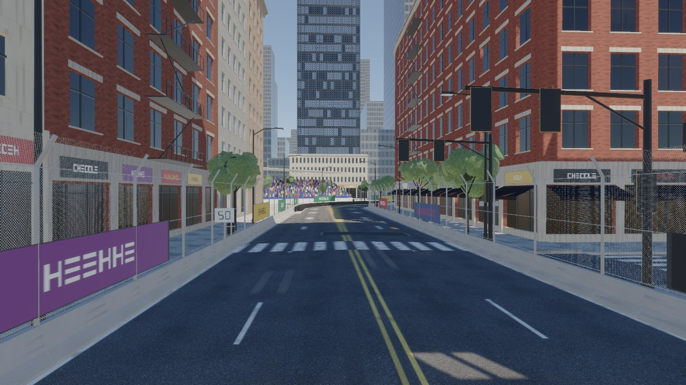
*Same view as the day braking zone with the procedural texture set only.*

## Honest assessment against the PLAN's bar (GTA V/VI quality)

What reads as a believable downtown street circuit, as far as lavapipe shows it: the road
(camber, gutter pans, worn markings, crosswalks, patches, cracks, manholes, drains, skid marks in
the braking zone, polished wheel tracks), the race dressing (barriers with fence and scrims,
curbs, tyre wall, gantry with start lights, boards, grandstand with crowd), street-level
composition (shopfronts with signage and awnings, lamps, signals, trees, furniture), believable
massing and skyline, and the lighting presets (sun and atmosphere by day, warm low sun at
golden hour, lit windows/shops/signs and pooled street lighting at night, mirror-like puddles
with screen-space reflections when wet).

Where it is clearly below the bar, roughly in order of visual impact:

1. **Asset fidelity.** Props and façades are honest low-poly procedural geometry (a lamp is
   ~180 triangles, a façade bay is a recessed box). GTA-class assets are 10–100× denser with
   bevelled edges, baked AO and hand-authored wear. The kit fixes *what goes where and at which
   scale*; the per-asset detail has to come from the PLAN section 7 asset pipeline (image-to-3D +
   Blender clean-up) dropped into the same slots and sockets.
2. **Global illumination and reflections.** There is no bounce light in the street canyons and
   glass reflects only the sky environment map (plus SSR on the wet road). Baked irradiance
   volumes and reflection probes per track (PLAN section 6) are the biggest single lighting step.
3. **Surface wear and grime.** Façades have no dirt streaks under sills, no grime at the base,
   no posters, graffiti or patched render; the road is the only surface with a decal layer.
4. **Life.** No traffic, pedestrians, steam, litter or animated signage; the crowd is blocks.
5. **Atmospherics.** No volumetric haze around lamps, no rain, ripples, spray or wet-lens
   effects; the wet preset is a dry-after-rain look.
6. **Software-rendering limits.** Captures use MSAA (or TAA when wet) at 1280×720; the wet
   preset still shows some specular sparkle and SSR noise that a GPU run with more samples and
   frames would resolve.

Verdict: a solid, data-driven blockout-plus layer, roughly at the level of an early
open-world street race game in composition and lighting, and a long way from GTA VI in
material and geometric density. The parts that scale (generators, rules, sockets, validation,
budgets, presets) are in place; fidelity now depends on better source assets, baked GI and a
grime/decal pass.

## Integration plan for M2 (`track.toml` / `racer-trackc`)

Written against `origin/m2-race-loop` (`data/tracks/downtown-loop/track.toml`,
`crates/racer-trackc`). The two fit together naturally: M2's route is a closed polyline of
corner nodes joined by circular fillets, which is exactly the kit's `path::Path` model
(straights + arcs); both use Bevy axes (+Y up, −Z north, `at = [x, z]`) and the
downtown-loop's main avenue even starts at `(0, 60)` heading north like the showcase street.

### What the kit consumes, and where it comes from

| Kit input | Already in M2 | Kit API it feeds |
|---|---|---|
| Centreline frames | `Geometry::samples`: every 1 m, `pos`, `tangent`, `right`, `up` (banked), `s`, `curvature` | sweeps take `&[mesh::Frame]`; a `Sample` maps 1:1 (`forward = tangent`) |
| Road width per sample | `Sample::half_width` (`width` per node, blended) | `RoadProfile` lanes: `lanes_per_side = round(half_width / 3.4)`, `lane_width = half_width / lanes` |
| Run-off / wall line | `Sample::apron`, `Sample::wall(side)`, `defaults.wall_height` | barrier offset = `wall(side)`; `jersey_run` (wall_height ≈ 0.8–1.1), `fence_run` on top |
| Curbs | `NodeFile::curbs`, `defaults.curb_width`, curb extents around each arc | `racing::curb_run` (replaces M2's two-colour curb meshes with the painted, wet-capable curb) |
| Start line, grid | `race.start`, `Geometry::grid` | `SurfaceParams::add_crossing(Chequered, ..)`, `racing::gantry` at `s = 0`; grid boxes stay M2 `markings` or become a 5th crossing kind |
| Sectors, checkpoints | `race.sectors`, `Geometry::sector_ends`, `checkpoints` | `racing::sector_board` at each sector end |
| Elevation, banking | node `elevation`, `bank_deg` → `Sample::pos/up` | free: sweeps use the sample frame (the kit's own `Path` is flat with constant grade) |
| Buildings | `Geometry::buildings` (greybox base, yaw, size) | each becomes a `building::Lot` rectangle; street-facing edges = edges facing the nearest sample; `assemble_block`/`build_with` with `district = "downtown"` |
| Braking zones | M2's speed profiles (`generated/speed-*.csv`) | `DecalRules::braking_zones` = intervals where the profile decelerates hard; distance boards 100/50 m before each |

### What `track.toml` still needs (proposal)

M2's structs use `deny_unknown_fields`, so these must be added to `data.rs`, all optional so
existing tracks keep loading:

```toml
[dressing]                     # optional; absent = greybox as today
district = "downtown"          # data/city/districts/<id>.toml
seed = 7
sidewalk = 4.5                 # m beyond the wall line; kerbs at the road edge
barrier = "jersey"             # default wall kind: jersey | armco | tyres | wall
fence = 3.6                    # catch fence height on barriers (0 = none)
lamp_spacing = 26.0

[[node]]                       # per-node overrides
barrier = ["tyres", "jersey"]  # left, right through this node's arc
junctions = [{ side = "left", at = 0.4, profile = "side_street", closed = true }]  # fraction along the straight after the node

[[grandstand]]
near = [0.0, -420.0]           # projected onto the route, like race.start
side = "left"
length = 36.0
rows = 12
```

### Pipeline

1. **`racer-trackc validate`** additionally checks the dressing: junction gaps do not overlap
   arcs or each other, grandstands fit between the wall line and the nearest building, and the
   district file parses (`District::load`).
2. **Geometry stays in `racer-trackc`.** Its road, wall and curb meshes remain the physics
   source (Avian trimesh with internal-edge fixing, as in M1/M2). Visual dressing is a layer on
   top: a `racer-citykit` adapter `dress(&Geometry, &Dressing) -> Batcher` turns samples into
   frames, sweeps road surface/kerbs/sidewalks/barriers/fences/curbs along them, places
   furniture by `s` and side, and assembles buildings on M2's footprints.
3. **Generate at load time.** The whole showcase street generates in ~0.13 s; the game should
   call the adapter at track load like M2 already does for geometry, rather than storing
   meshes. Textures: the scans load in ~7–8 s in a debug build (JPEG decode + CPU mips); for
   the game, cache them as KTX2 with mips under `assets/` by content hash.
4. **Physics surfaces.** Map M2's meshes to `racer-dynamics` surfaces: road → asphalt (dry/wet
   from the `Wetness` resource), curbs → curb, aprons/sidewalk → concrete. Painted lines do not
   need triangles: lane-line positions are closed-form in (u, s) from the same `SurfaceParams`.
5. **AI and lighting.** The racing line keeps reading M2 geometry (dressing never narrows the
   drivable width, since barriers sit at `wall(side)`). Lamp sockets become spot lights through
   `showcase::spot_intensity`; per-track baked GI/reflection probes come later (PLAN section 6).

Nothing here requires changing M2's existing behaviour; the kit only depends on
`racer-render` (one new module, `surface`) and adds two scenes to `racer-capture`.

## Verification

| Check | Result |
|---|---|
| `cargo fmt --all --check` | clean |
| `cargo clippy --workspace --all-targets --locked -- -D warnings` | clean |
| `cargo test --workspace --locked` | 75 tests pass (34 in `racer-citykit`, 3 in `racer-render::surface`, the rest unchanged) |
| `racer-citykit validate` | 38/38 assets pass |
| Cross-target clippy (`CARGO_FEATURE_PURE=1`, `-D warnings`) | `x86_64-pc-windows-msvc` and `aarch64-apple-darwin` clean |
| `tools/capture.sh downtown-kit{,-golden,-night,-wet,-procedural}` | all pass the harness image check; inspected by eye |

`racer-citykit` tests cover: noise periodicity and determinism; mesh primitives and sweeps
watertight with outward volume (including concave profiles); path geometry (corner end pose,
offset arc lengths); road meshes finite, upward carriageway, kerbs/sidewalks watertight;
decals deterministic, on the road, atlas UVs in range; textures deterministic, in range,
plausible asphalt albedo, seamless tiling, full mip chains; block subdivision covers the
block; buildings deterministic and in budget for every archetype; district rules parse and
reject bad ranges; the whole catalogue validates, names unique, deterministic; lamp sockets
point down; showcase layout deterministic and within draw/triangle/light budgets; spot-light
intensity conversion; side streets meet the frontage.

## Not done / next steps

- Blender contact-sheet review (`tools/kit_review.sh`) was written but not run (cancelled).
- No `dress(&racer_trackc::Geometry)` adapter yet: the integration plan above describes it,
  but M2 had not landed on `main`, and this branch must not touch `racer-trackc`.
- Goldens for the `downtown-kit` scenes are not committed (the scenes take minutes on lavapipe
  and the look is still being tuned); the screenshots above are the reference.
- Scanned textures should be cached as KTX2 (texture setup is ~7–8 s in a debug build).
- Façade grime/decal pass, building ornament variety, baked GI/reflection probes, rain and
  spray, traffic and pedestrians (see the assessment).
